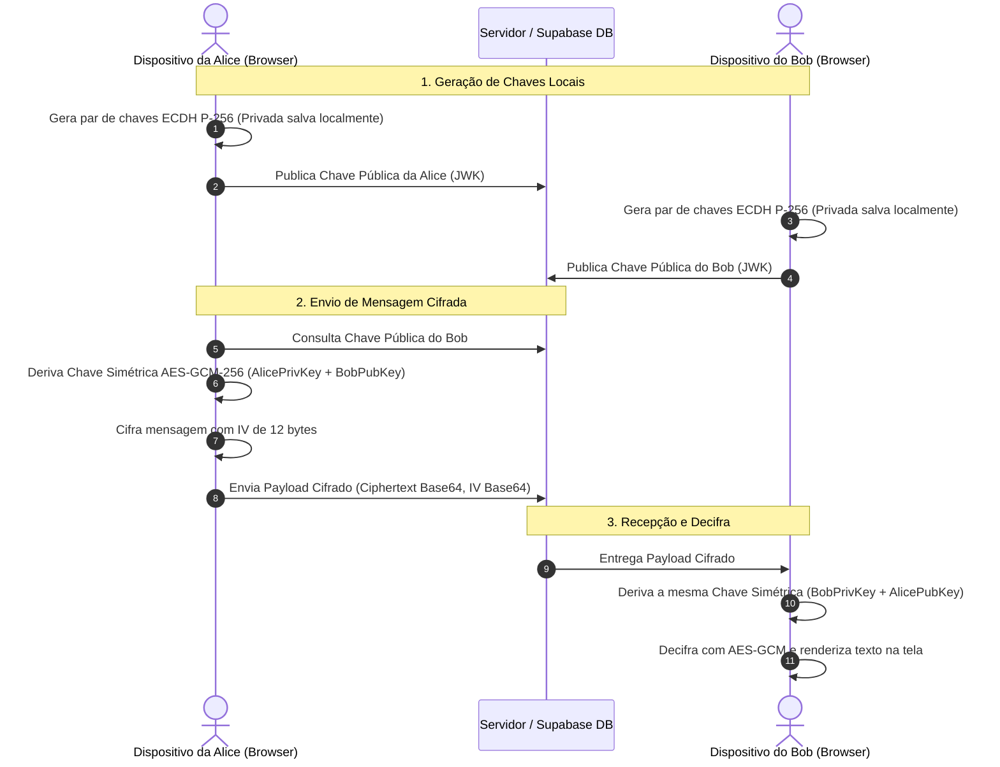

# ESPECIFICAÇÃO DE ARQUITETURA E SEGURANÇA: MENSAGENS E2EE (FASE 6 CONCLUÍDA)

Este documento estabelece as decisões técnicas, garantias criptográficas e limites de segurança implementados na mensageria de ponta a ponta (**End-to-End Encryption**) do **VÉRSE**.

---

## 1. Princípios Criptográficos Implementados

1. **Zero Texto Claro no Servidor:** O servidor e o banco de dados recebem, transmitem e armazenam estritamente blobs criptografados opacos em formato Base64 (`ciphertext` e `iv`). O texto claro existe apenas transitoriamente na memória volátil do navegador de cada participante.
2. **Sem Chaves Privadas no Servidor:** As chaves privadas ECDH P-256 são geradas e armazenadas exclusivamente no cliente (`localStorage` / `IndexedDB`) do dispositivo local. Nem moderadores nem administradores possuem meios de recuperá-las ou interceptá-las.
3. **Não Inventar Criptografia (Padrões W3C / NIST):** Todas as operações utilizam a **Web Crypto API** nativa (`crypto.subtle`), suportada universalmente por todos os navegadores modernos e acelerada por hardware no sistema operacional:
   - **Troca de Chaves Assíncrona:** Elliptic Curve Diffie-Hellman (**ECDH**) sobre a curva **NIST P-256** (FIPS 186-4).
   - **Cifra Simétrica Autenticada:** **AES-GCM-256** (Galois/Counter Mode) com chave derivada de 256 bits.
   - **Vetor de Inicialização (IV):** 96 bits (12 bytes) criptograficamente pseudoaleatórios únicos por mensagem (`crypto.getRandomValues`).
   - **Integridade e Anti-Tampering:** Tag de autenticação de 128 bits do AES-GCM; qualquer alteração no tráfego ou no banco é detectada e a decifra é sumariamente abortada com erro.
4. **Sem Fallback para Texto Puro:** Falhas de descriptografia (ex: chave divergente, payload corrompido) exibem alerta explícito de erro criptográfico e nunca recorrem a texto simples.
5. **Isolamento de IA:** As mensagens privadas E2EE são 100% isoladas de qualquer modelo de inteligência artificial, garantindo sigilo absoluto.

---

## 2. Fluxo Criptográfico Passo a Passo

---

## 3. Verificação Contra Ataques Man-in-the-Middle (Safety Numbers)

Para mitigar ataques em que uma infraestrutura maliciosa pudesse substituir a chave pública de um participante durante a negociação, o VÉRSE implementa o cálculo de **Safety Numbers**:
- É calculado um hash SHA-256 combinando ordenadamente as coordenadas das chaves públicas de Alice e Bob:
  $$\text{Fingerprint} = \text{SHA-256}(\text{"verse\_safety\_v1:"} \parallel \min(K_A, K_B) \parallel \max(K_A, K_B))$$
- O resultado é formatado em 4 blocos de 5 dígitos numéricos legíveis (`XXXXX XXXXX XXXXX XXXXX`).
- Alice e Bob podem comparar visualmente ou via canal de voz fora de banda para certificar que estão se comunicando com o dispositivo legítimo.

---

## 4. Auditoria de Carga Cifrada no Frontend

O usuário dispõe na interface de mensagens de um botão **"Inspecionar Carga"**, que exibe o `ciphertext` e o `iv` reais armazenados no banco, demonstrando empiricamente que os dados transmitidos são indecifráveis sem a posse física da chave privada do dispositivo.

---

## 5. Limitações Conhecidas e Próximos Passos (Evolução Futura)

- **Múltiplos Dispositivos Simultâneos:** No modelo atual, as chaves residem no dispositivo emissor/receptor. Sincronização multi-dispositivo sem comprometer o sigilo requer mecanismo de sessão por dispositivo (Fan-out de mensagens cifradas para todos os dispositivos registrados do usuário).
- **Forward Secrecy Total (Double Ratchet):** Para rotação contínua de chaves a cada troca de mensagem individual (Signal Protocol completo), uma camada Double Ratchet com KDF Chains pode ser adicionada sobre a base ECDH P-256 atual.
